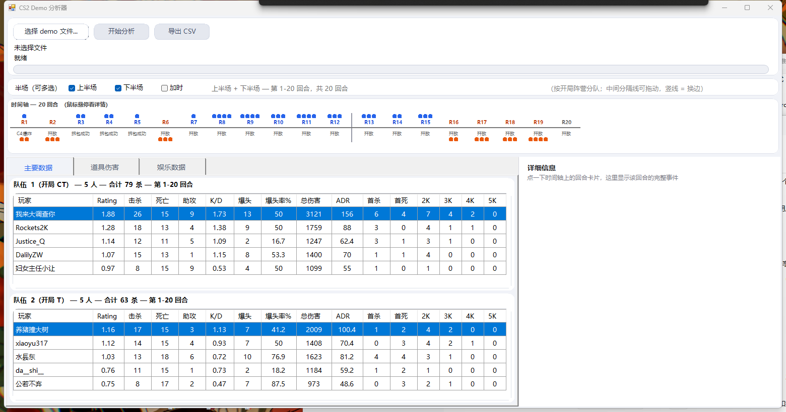

# CS2 Demo 分析器

> 导入 CS2 / CS:GO 的 `.dem` 录像，按**半场**分段、按**队伍**上下分栏，统计每个玩家的表现。

一个 Windows 上的本地小工具：双击就能开，选一个 demo，点「开始分析」，
几秒后得到一份看得懂的战绩表 —— 谁的 Rating 最高、谁的爆头率离谱、谁在丢雷、
谁在打队友，一眼扫完。



## 功能

- **按半场切分**：上半场 / 下半场 / 加时三段，可以**多选叠加**看合并数据。
- **按队伍分栏**：上下两队固定成「队伍 1 / 队伍 2」名册，中途换边也不会串。
  中间的**分隔线可以拖**，想给哪个队多看几行就往上 / 往下拉。
- **回合时间轴**：一条轴线画完所有回合，轴上是双方结束时存活人数，
  鼠标悬停出悬浮窗，**单击**出右侧完整事件时间轴 ——
  `1:55 5v5 回合开始 → 1:46 … [ssg08] 击杀 … → 0:35 反恐精英获胜 拆包成功`。
- **三个页签**：主要数据 / 道具伤害 / 娱乐数据。
- **导出 CSV**：当前视图一键导出。


| 页签 | 看什么 |
|---|---|
| **主要数据** | Rating、击杀 / 死亡 / 助攻、K/D、爆头率、ADR、总伤害、首杀 / 首死、2K~5K |
| **道具伤害** | 手雷 / 燃烧 / 诱饵伤害、道具总伤、**道具占比**、每回合道具伤害、闪光助攻 |
| **娱乐数据** | 杀鸡、刀杀、电击枪杀、下包 / 拆包、Teamkill、自杀、**团队伤害（友军火力）** |

## 快速开始

### 1. 环境要求

- Windows + PowerShell 5.1（系统自带）
- Python 3.10+

```
python -m pip install demoparser2 pandas
```

### 2. 启动

双击 `CS2Demo分析器.exe` 即可，不会弹终端。

（等价入口：`启动.vbs`，或用命令行 `powershell -STA -NoProfile -ExecutionPolicy Bypass -File DemoAnalyzer.ps1`。）

### 3. 使用

点「选择 demo 文件...」→ 选一个 `.dem` → 点「开始分析」。
CS2 默认的 demo 目录在：

```
...\SteamLibrary\steamapps\common\Counter-Strike Global Offensive\game\csgo\
```

## 项目结构

```
DemoAnalyzer.ps1     客户端（WinForms 界面 + 调用分析器 + 全部绘制）
CS2Demo分析器.exe     无控制台启动器（src/Launcher.cs 编译产物）
src/Launcher.cs      启动器源码
src/analyzer.py      分析核心：解析 demo，输出 out/report.json
启动.vbs / 启动.bat   备用启动入口
docs/技术说明.md      完整技术文档（口径、公式、踩坑记录）
screenshots/         界面截图
out/                 运行产物（report.json / progress.json / 截图）
*.ps1                各个回归测试与出图脚本
```

## 数据口径（挑几条容易踩的）

- **总伤害只算敌人的实际掉血**。`player_hurt` 里的 `dmg_health` 是**没截断**的原始伤害，
  AWP 爆头一枪就是 438，但满血只有 100，直接累加会把溢出伤害也算进去（实测虚高 26%）。
  现在按「打之前的血量」做上限。
- **Rating 是近似 HLTV Rating 2.0**，不是官方数字。
  本局标定平均 1.13（理想 1.00），权重经过两轮调整让击杀项成为最大项。
- **玩家以名字归并**，SteamID64 超过 float64 精度（>2^53），经 pandas 读取末位会漂移，
  所以只用来展示，不做关联键。
- **半场分界写死 MR12**。非标准模式需要改 `HALF_ROUNDS`。

完整的公式推导、权重标定过程、以及一堆 WinForms / PowerShell 的坑，
都写在 **[docs/技术说明.md](docs/技术说明.md)** 里。

## 回归测试

这些脚本都不需要人手点，跑完打印 OK / FAIL：

```powershell
powershell -NoProfile -ExecutionPolicy Bypass -File uicheck.ps1     # 界面结构与配色
powershell -NoProfile -ExecutionPolicy Bypass -File clicktest.ps1   # 真实按钮回调 + 进度条采样
powershell -STA -NoProfile -ExecutionPolicy Bypass -File dragtest.ps1     # 分隔条 / 表格平移 / 边界钳制
powershell -STA -NoProfile -ExecutionPolicy Bypass -File tltest.ps1       # 时间轴布局与拖动
powershell -STA -NoProfile -ExecutionPolicy Bypass -File ratingtest.ps1   # 两份 Rating 实现逐条对账
powershell -STA -NoProfile -ExecutionPolicy Bypass -File detailtest.ps1   # 详情栏单击 / 拖动不误触发
powershell -STA -NoProfile -ExecutionPolicy Bypass -File bartest.ps1      # 自绘进度条像素级对账
```

> 它们读的是 `out/report.json`，也就是**最近一次分析的结果**。
> 分析任何 demo 都会覆盖它，所以换过 demo 之后测试照样跑得过
> （断言都是「按叠加重算 == 叠加」这类自洽关系）。

## 已知限制

- 只支持 MR12；加时面板在没加时的对局里是空的。
- 队伍名只能叫「队伍 1 / 队伍 2」：demo 里 `team_clan_name` 实测是空串。
- 分析期间不能取消（没有取消按钮）。
- 时间轴只列事件，不能播放回放，也没有热力图。
- 详情里的武器是文字（`[awp]`），没有图标。

## License

MIT
