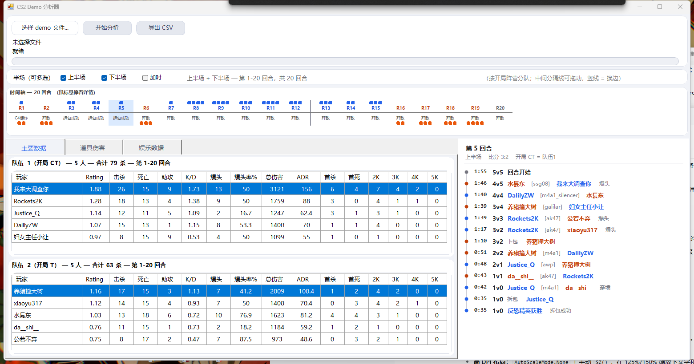
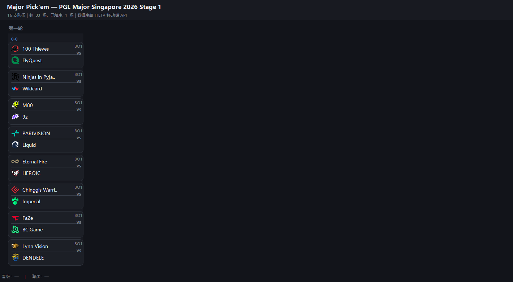

# CS2 工具

> 一个本地运行的 CS2 小工具集合。左侧导航切换功能，右侧显示内容。

两块功能：**Demo 统计**（导入 `.dem` 录像做逐玩家战绩）和 **Major Pick'em**
（HLTV Major 实时数据 + Valve Swiss 规则推演）。


## 功能

### Demo 统计

导入 CS2 / CS:GO 的 `.dem` 录像，按**半场**分段、按**队伍**上下分栏统计每个玩家的表现。

- **按半场切分**：上半场 / 下半场 / 加时三段，可以**多选叠加**看合并数据。
- **按队伍分栏**：上下两队固定成「队伍 1 / 队伍 2」名册，中途换边也不会串。
- **回合时间轴**：悬停出悬浮窗，**单击**出右侧完整事件时间轴。
- **三个页签**：主要数据 / 道具伤害 / 娱乐数据。
- **导出 CSV**。



### Major Pick'em



按 **Valve Swiss 规则**画对阵图，**点某一队就是判它赢**，对阵自动推进到下一轮。

- 每一列是一轮，列内按战绩分组（`0-0` / `1-0` / `0-1` …）
- 队伍带**真实 Logo**，赢的行高亮，输的行变暗
- 整张图**按住鼠标可拖动**，滚轮上下滚
- 已结束的比赛会自动套用真实赛果
- 底部实时显示「晋级 / 淘汰」名单

#### 晋级规则

| 阶段 | 规则 |
|---|---|
| **首轮配对** | 按种子对折：1 号打 9 号、2 号打 10 号 … 8 号打 16 号（种子差恒为 8） |
| **之后每轮** | 按当前战绩分组，赢一场进「胜场+1」的组，输一场进「负场+1」的组 |
| **组内排序** | Buchholz 规则（对手胜场和），并避开已经交手过的队伍 |
| **BO 格式** | 2 胜或 2 负的组打 BO3，其余 BO1 |
| **晋级** | 先到 **3 胜**直接晋级（3-0 / 3-1 / 3-2） |
| **淘汰** | 先到 **3 负**直接淘汰（0-3 / 1-3 / 2-3） |

## 快速开始

### 1. 环境要求

- Windows + PowerShell 5.1（系统自带）
- Python 3.10+，Demo 统计需要 `demoparser2` 与 `pandas`

```
python -m pip install demoparser2 pandas
```

### 2. 启动

双击 `CS2Demo分析器.exe`，不会弹终端。

### 3. 更新 Pick'em 数据

```bash
python tools/hltv_mobile.py --event 9303
```

`--event` 是 HLTV 的事件 ID（9303 = PGL Major Singapore 2026 Stage 1）。
用 `--majors` 可以列出当前所有 Major 事件。

## 数据从哪来

**HLTV 移动端 API**：`https://www.hltv.org/mobile/`

网页版挂了 Cloudflare，实测这些通道全部被拦：

| 通道 | 结果 |
|---|---|
| Python urllib / requests | 403 `Just a moment...` |
| curl（全套浏览器头） | 403 |
| Node fetch | 403 |
| Edge `--headless=new --dump-dom` | 返回「请稍候…」挑战页 |

但**官方 Android 客户端**用的是另一套接口，只认移动端 UA：

```
User-Agent: org.hltv.android/3.0.34;release(Android; SM-S918B; Android 14)
```

这套接口**不需要 cookie、不需要代理、不需要人机验证**，直接 GET 就返回 JSON：

| 端点 | 返回 |
|---|---|
| `/mobile/startupCheck` | 200 |
| `/mobile/MatchesV4` | 200（~1.5MB，全部比赛 + 队伍 + Logo） |
| `/mobile/MatchScreen?matchId=…` | 200（单场详情） |

少数端点要求完整性签名（如 `/FrontpageV2` 返回 `integrity_required`），
但比赛相关接口都能用，足够本项目使用。

> 这个思路来自 GitHub 上的 [pickem-prediction-model](https://github.com/Leclowndu93150/pickem-prediction-model)
> 项目——它用 `hltv_api` 包装了同一套移动端接口。

## 项目结构

```
DemoAnalyzer.ps1         主程序（导航壳 + WinForms + 自绘对阵图）
CS2Demo分析器.exe         无控制台启动器
src/Launcher.cs          启动器源码
src/analyzer.py          demo 分析核心
tools/hltv_mobile.py     HLTV 移动端 API 抓取
data/major-live.json     Major 实时数据
data/hltv-major.json     旧的整页快照（兜底）
assets/logos/            队伍 Logo（PNG）
docs/技术说明.md          完整技术文档
screenshots/             界面截图
```

## 数据口径（挑几条容易踩的）

- **总伤害只算敌人的实际掉血**。`dmg_health` 是**没截断**的原始伤害，
  AWP 爆头一枪 438 但满血只有 100，直接累加会虚高 26%。
- **Rating 是近似 HLTV Rating 2.0**，不是官方数字。
- **玩家以名字归并**，SteamID64 超过 float64 精度（>2^53），末位会漂移。
- **半场分界写死 MR12**。

详见 **[docs/技术说明.md](docs/技术说明.md)**。

## 回归测试

```powershell
powershell -NoProfile -ExecutionPolicy Bypass -File DemoAnalyzer.ps1 -SelfTest
powershell -NoProfile -ExecutionPolicy Bypass -File uicheck.ps1
powershell -NoProfile -ExecutionPolicy Bypass -File clicktest.ps1
powershell -STA -NoProfile -ExecutionPolicy Bypass -File dragtest.ps1
powershell -STA -NoProfile -ExecutionPolicy Bypass -File tltest.ps1
powershell -STA -NoProfile -ExecutionPolicy Bypass -File ratingtest.ps1
```

## 已知限制

- 只支持 MR12。
- 队伍名只能叫「队伍 1 / 队伍 2」：demo 里 `team_clan_name` 是空串。
- 分析期间不能取消。
- Pick'em 的 Stage 2 / Stage 3 数据要换 `--event` 重新抓；
  部分队伍（如 Astralis、MOUZ）HLTV 只给 SVG，PNG 转换会被签名拦住。
- Tab 顺序按事件分组，跨阶段不会自动衔接。

## License

MIT
